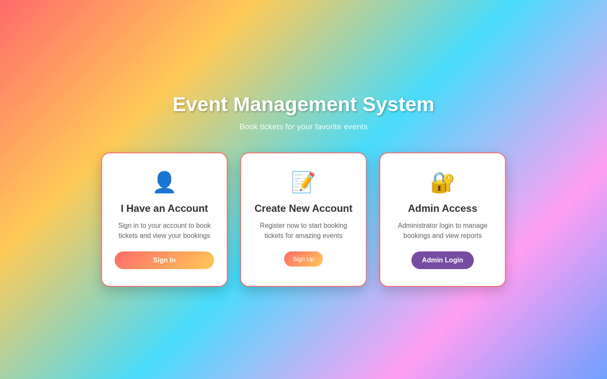
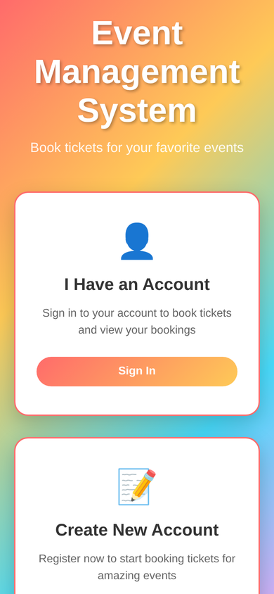

<h1 align="center">Event Management & Ticket Booking System</h1>

<p align="center"><em>Browse events, book tickets and manage everything from an admin dashboard</em></p>

<p align="center">
  
  
  
</p>

<p align="center"><a href="https://event-management-tickets-booking77.netlify.app/"><strong>🔗 Live Demo</strong></a></p>

<p align="center"></p>

## 📖 Overview

A web-based event management and ticket booking platform designed to organize events, present event information, and provide a streamlined ticket booking experience. Users can create an account, browse available events and book tickets, while an administrator gets an overview of events, bookings and registered users.

## ✨ Features

- **User accounts** — sign in or create a new account
- **Admin access** with a separate administrator login
- Browse **available events** (music festival, tech conference, football championship, classical concert, food festival)
- **Book tickets** through a booking modal with a live total
- **My Bookings** — view and cancel your bookings
- **My Profile** — view and update user details
- **Admin dashboard** — stats overview, recent bookings, all bookings, registered users and all events
- Data persisted in the browser with `localStorage` in the deployed demo

## 🛠️ Tech Stack

| Layer | Technology |
|---|---|
| Markup | HTML5 |
| Styling | CSS3 |
| Logic | Vanilla JavaScript |
| Storage (demo) | Browser localStorage |
| Hosting | Netlify |

## 📸 Screenshots

**Home**


**Mobile**



## 🌐 Live Demo

https://event-management-tickets-booking77.netlify.app/

## 🚀 Getting Started

No build step needed — it's a static site.

```bash
git clone https://github.com/Mo-aini/event-management-ticket-booking.git
cd event-management-ticket-booking
```

Then open `index.html` in your browser, or serve the folder locally:

```bash
# Option 1: Python
python -m http.server 8000
# Option 2: Node
npx serve .
```

Visit `http://localhost:8000`. You can also use the **Live Server** extension in VS Code.


## 📁 Project Structure

```
event-management-ticket-booking/
├── screenshots/
│   ├── home.png
│   └── mobile.png
├── .gitignore
├── index.html
├── LICENSE
├── README.md
└── styles.css
```

## 📝 Notes

The project was designed alongside a SQL Server database; the deployed demo in this repository is the client-side web application, which stores its data in the browser.

---

<div dir="rtl">

## 🇾🇪 بالعربي

نظام ويب لإدارة الفعاليات وحجز التذاكر: المستخدم يسجّل حساب ويتصفح الفعاليات المتاحة ويحجز تذاكر ويشوف حجوزاته ويلغيها، والأدمن عنده لوحة تحكم فيها إحصائيات وكل الحجوزات والمستخدمين والفعاليات.

**التقنيات:** HTML و CSS و JavaScript.

**التشغيل:** افتح `index.html` بالمتصفح.

**الرابط المباشر:** https://event-management-tickets-booking77.netlify.app/

</div>

---

## 👤 Author

**Mohammed Emad ALaini** — Software Engineering student & Full-Stack Developer

- Portfolio: [mohammedemad.netlify.app](https://mohammedemad.netlify.app/)
- GitHub: [@Mo-aini](https://github.com/Mo-aini)
- LinkedIn: [Mohammed Emad](https://www.linkedin.com/in/mohammed-emad-24a841373)

## 📄 License

This project is licensed under the [MIT License](LICENSE).
